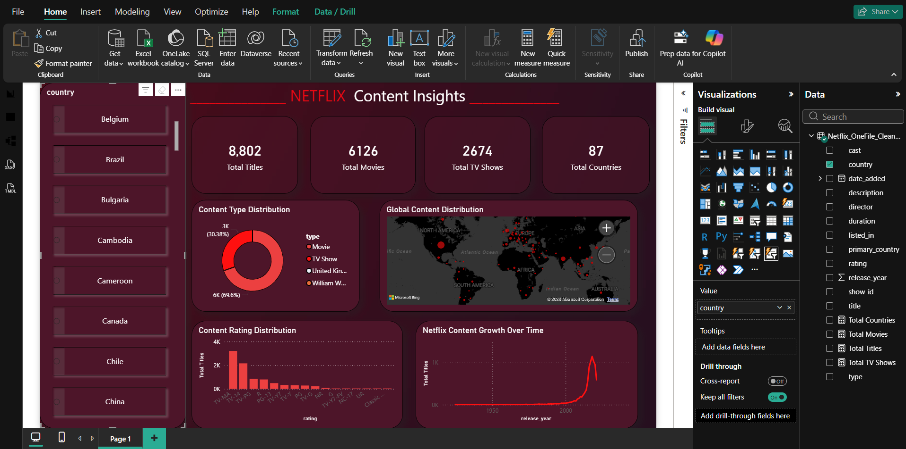

# Netflix Content Analysis — Power BI Dashboard

An interactive Power BI dashboard exploring the Netflix catalogue, including content type, genre distribution, production countries and release-year trends.

## Dashboard preview

  

## Open the project files

- [Power BI dashboard (.pbix)](PowerBI/Netflix_Dashboard.pbix)
- [Cleaned Netflix dataset](Data/Netflix_OneFile_Cleaned_Final.csv)
- [Original compressed dataset](Data/netflix_titles.csv.zip)
- [Dashboard preview image](Images/dashboard_preview.png)

Open the PBIX file in Power BI Desktop to use the report's interactive controls.

## Business questions

This dashboard is designed to help explore:

- What is the distribution of movies and TV shows?
- Which genres appear most frequently in the catalogue?
- Which countries are most represented?
- How does content volume vary by release year?
- How do catalogue patterns change when filtering by content type, country, genre or year?

## Dashboard features

- Movie and TV show comparison.
- Country-level content distribution.
- Genre-level analysis.
- Release-year trend analysis.
- Interactive slicers for Type, Country, Genre and Release Year.

## Key measures

The report uses DAX measures to calculate:

- Total Titles
- Total Movies
- Total TV Shows
- Movie and TV Show share of total titles

## Data preparation

The repository contains an original compressed CSV and a cleaned CSV used by the report. The documented preparation includes reviewing the dataset, handling missing values, standardising country and genre fields, and creating calculated fields and measures for reporting.

## Tools and skills

| Tool | Use |
|---|---|
| Power BI | Interactive dashboard and reporting |
| DAX | KPI and calculation logic |
| Power Query | Data cleaning and transformation |
| CSV | Dataset storage |
| GitHub | Project documentation and version control |

## Repository structure

- \`Data/Netflix_OneFile_Cleaned_Final.csv\` — cleaned dataset used for analysis
- \`Data/netflix_titles.csv.zip\` — compressed source dataset
- \`Images/dashboard_preview.png\` — dashboard screenshot
- \`PowerBI/Netflix_Dashboard.pbix\` — Power BI report

## Interpretation notes and limitations

This project describes patterns in the dataset used for the analysis. Catalogue counts and country or genre rankings should not be treated as a live representation of Netflix's current catalogue. Genre and country fields may contain multiple values per title, so category totals may overlap.

The repository includes the report and datasets, but does not currently include a separate step-by-step cleaning notebook. The preparation summary above should therefore not be mistaken for a fully reproducible transformation script.

## Author

**Vaibhav Deshmukh**  
Aspiring Data Analyst | Power BI | SQL | Python

[GitHub profile](https://github.com/vaibhavd8080)